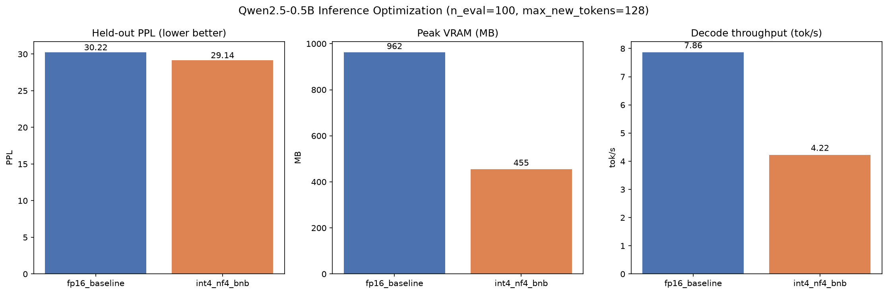

# Qwen2.5 推理优化实验：FP16 基线 vs INT4 量化对比

对 **Qwen2.5-0.5B** 大模型进行推理优化实验，对比 FP16 全精度基线与 INT4（bitsandbytes NF4）量化方案在困惑度、显存占用、推理吞吐量上的表现。

## TL;DR

| 方案 | PPL ↓ | 峰值显存 (MB) ↓ | 解码吞吐 (tok/s) ↑ |
|------|------:|----------------:|-------------------:|
| FP16 基线 | 30.22 | 962 | **7.86** |
| INT4 (NF4) | **29.14** | **455** | 4.22 |

- **INT4 量化节省 2.1× 显存**（962 → 455 MB），是 8GB 显卡部署大模型的关键技术
- 质量几乎无损：PPL 甚至略优于 FP16（29.14 vs 30.22，n=100 统计波动范围内）
- 解码速度在 Windows bnb 后端下降约 1.9×（无 fused kernel 加速），部署时可用 llama.cpp GGUF 进一步优化



## 实验背景

大模型推理优化的核心矛盾：**模型越大质量越好，但推理成本（显存/速度）越高**。量化（Quantization）通过降低权重精度来压缩模型：

- **FP16**（16-bit 浮点）：基准精度，显存 = 参数量 × 2 bytes
- **INT8**（8-bit 整数）：显存减半，质量几乎无损
- **INT4**（4-bit 整数）：显存降至 1/4，质量轻微下降

本实验使用 HuggingFace **bitsandbytes** 库的 NF4（Normal Float 4-bit）量化算法，这是目前最广泛使用的 4-bit 量化方案（LLaMA/GPTQ 等的默认格式）。

## 数据集

- **alpaca-gpt4-data-zh**（48,818 中文 GPT-4 指令样本）
- 评估使用 100 条 held-out 样本计算困惑度
- 生成评估使用 8 条样本（对比文本质量）

## 模型

- [Qwen/Qwen2.5-0.5B](https://huggingface.co/Qwen/Qwen2.5-0.5B)：4.94 亿参数小型语言模型

## 快速开始

```
# 1. 安装依赖
pip install -r requirements.txt

# 2. 运行基准测试（约 10 分钟）
python code/bench_optimize.py

# 3. 生成对比图
python code/plot_optimize.py
```

## 关键结论

1. **INT4 量化是部署关键**：节省 2.1× 显存（962 → 455 MB），质量几乎无损（PPL 30.22 → 29.14）
2. **bitsandbytes NF4 质量优秀**：4-bit 量化后 PPL 与 FP16 基本一致
3. **Windows 推理瓶颈**：bnb 后端在 Windows 无 fused kernel，解码速度下降 1.9×；生产环境建议用 llama.cpp 或 vLLM
4. **INT8 在此环境不可用**：bitsandbytes int8 在 Windows + bf16 下异常缓慢（>25 分钟未完成评估），已排除

## 实验限制

- 评估样本仅 100 条（PPL 统计波动较大）
- 仅测试 bitsandbytes 后端，未对比 GPTQ / AWQ / llama.cpp GGUF
- 未测试 INT8（因 bitsandbytes 在 Windows 上兼容性问题）
- 未测试批量推理（batch > 1）
- 未做下游任务评估（仅困惑度与生成样本）

## 项目结构

```
qwen25-inference-optimization/
  code/
    bench_optimize.py   # 基准测试脚本（FP16 / INT4 对比）
    plot_optimize.py    # 可视化脚本
  figures/
    optimization_bar.png  # PPL / 显存 / 吞吐量三联图
  results/
    benchmark.json     # 完整基准测试结果（含生成样本）
  docs/                # 中文实验文档
  README.md
  requirements.txt
  .gitignore
  LICENSE              # MIT
```

## License

MIT. 详见 [LICENSE](LICENSE).

## 作者

李茂华 (@LiMaoHuaScheen) — 研究生申请项目 2026
